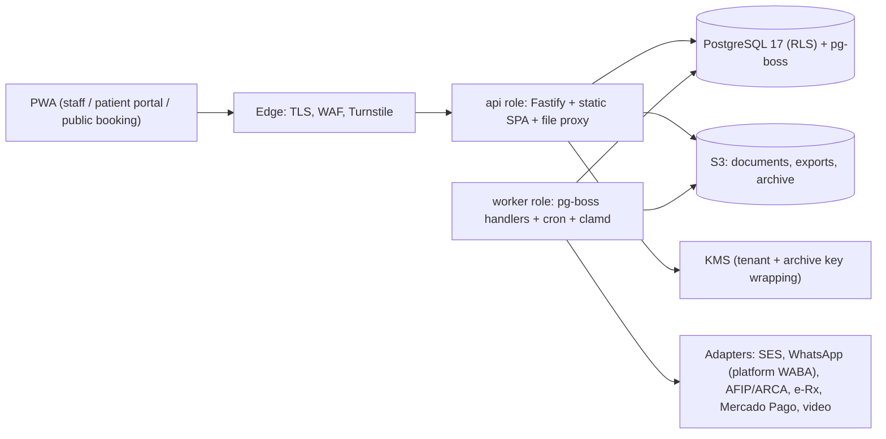
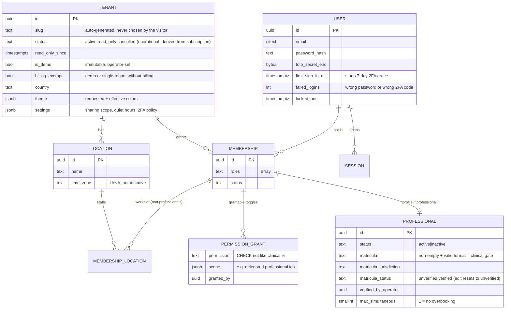
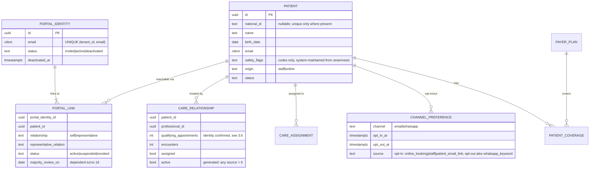
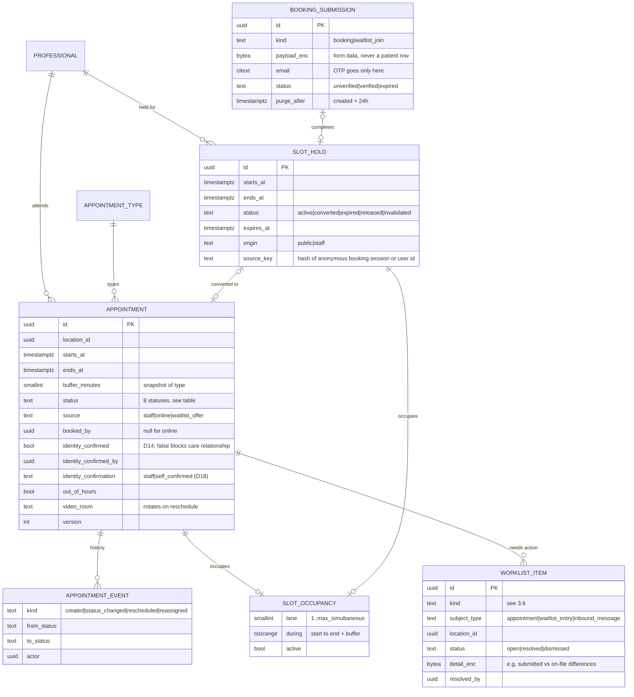
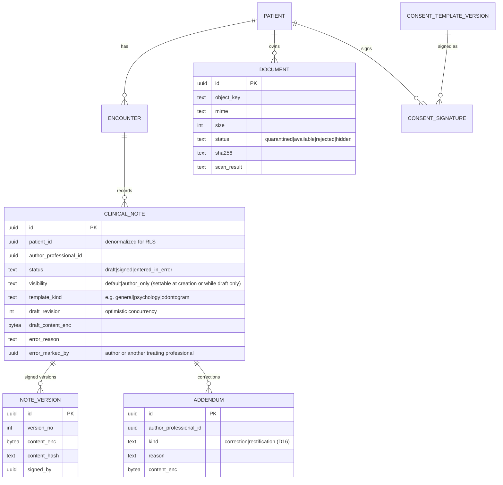
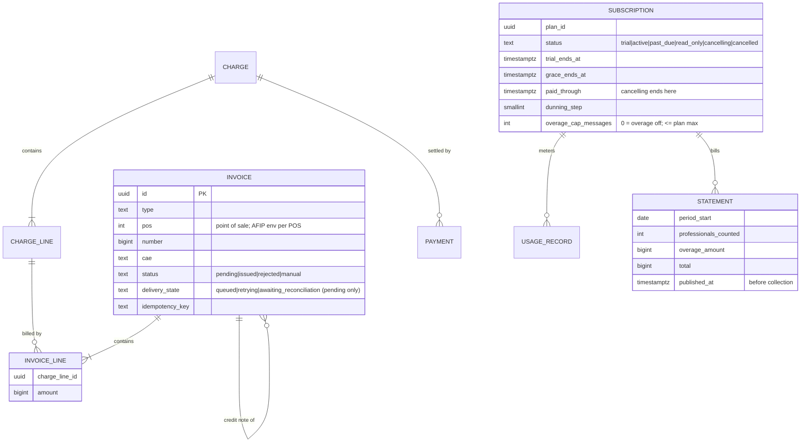
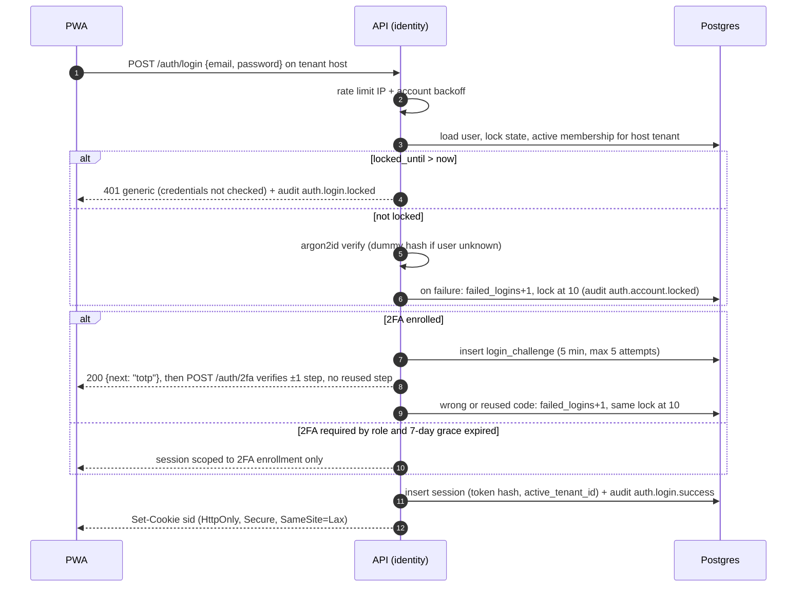
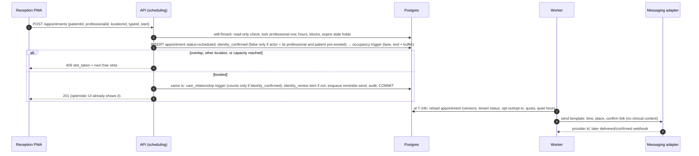
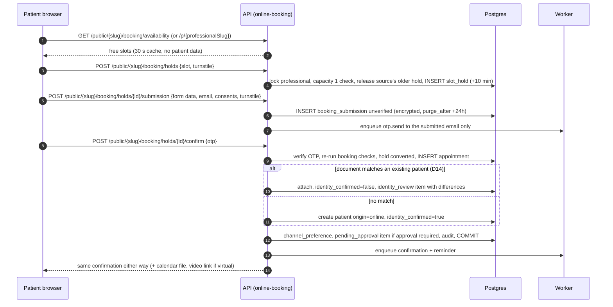
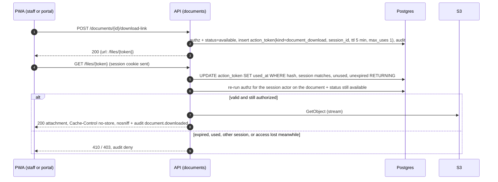

# Design: Health Practice SaaS (rewrite of Centro Medico Aillu)

> **Decision in one line**: A TypeScript modular monolith (Fastify API + React/Vite PWA) in a pnpm monorepo at the repo root. It runs on PostgreSQL with row-level security as the tenant and clinical-access backstop, pg-boss jobs in the same database, and S3 object storage. The whole thing ships as one container image (roles `api` and `worker`) on AWS `sa-east-1`, behind ports and adapters for every external provider.

**Reading order**: 1 Stack ADR → 2 Architecture → 4 Tenancy and security → 5 Sequences → 10 Stages. Where this design and a spec disagree, the spec defines behavior and this document defines mechanism.

**Amendment 1 (2026-10-15)**: aligned with gate review 1 and the binding product-owner decisions D1–D13. §14 maps every finding to the section that resolves it.

**Amendment 2 (2026-10-15)**: aligned with gate review 2 (D14–D18, F1–F16) in one pass with the specs. §15 maps every fix. The canonical lists (appointment statuses, care-relationship sources, read-only allowlist, retention exceptions, token kinds, invoice and subscription states) live in §3.6, §4.5 and §7 and are copied word for word into the specs.

---

## 1. Stack decision (ADR-001)

| Layer | Choice | Why it fits this owner and product |
|---|---|---|
| Language | TypeScript (strict) end to end, Node 24 LTS | Builds on the owner's existing JS/React/Node skills. Shared types between API and UI. |
| API | **Fastify** + Zod type provider | Feels like Express (which the owner knows) and adds schema-first validation, encapsulated plugins and good performance. |
| DB | **PostgreSQL 17** | Row-level security, exclusion constraints (no double booking), `jsonb` templates, PITR on managed hosting. |
| Data access | **Drizzle ORM** + drizzle-kit migrations | Reads like SQL (close to the owner's mysql2 habits), declares RLS policies in code, and handles transaction-scoped `set_config` cleanly. |
| Jobs / scheduler | **pg-boss** (Postgres-backed) | No Redis to run. Jobs are enqueued in the same transaction as the business write, so it doubles as an outbox. Has cron schedules. |
| Web | **React 19 + Vite + TanStack Router + TanStack Query** | SPA/PWA with typed routes. Calendar-heavy authenticated app, where SEO is irrelevant. |
| UI | **Tailwind 4 + shadcn/ui (Radix) + lucide** | Same stack the owner already uses. CSS-variable tokens make per-tenant theming straightforward. |
| Forms | react-hook-form + Zod (shared schemas) | One schema validates on both client and server. |
| PWA | vite-plugin-pwa (Workbox) | Precaches the app shell. API is network-only, so no clinical data is cached offline. |
| i18n | i18next + `Intl` | es-AR first. Message keys are shared with API errors. |
| PDF | @react-pdf/renderer (in the worker) | Invoices, exports and consents written as React components. |
| Malware scan | **ClamAV (`clamd`) sidecar** in the worker task | Required by `documents`. Free, offline signatures, `INSTREAM` over TCP. |
| Tests | Vitest, Testcontainers (Postgres), Playwright + axe | Isolation tests run against real RLS. |

**Rejected alternatives**

| Option | Tradeoff | Verdict |
|---|---|---|
| Next.js full-stack (App Router, server actions) | One framework and SSR. But server actions blur the hexagonal boundaries, per-request RLS transactions are awkward across RSC/middleware, there is pull toward Vercel (no AR-adequate region), and SSR adds little to an authenticated calendar app. | Rejected |
| NestJS + Prisma | Strong structure out of the box. But heavy decorator/DI ceremony for one developer, and Prisma makes transaction-scoped RLS context clumsy (needs interactive transactions plus extensions). | Rejected |
| Better Auth (instead of custom sessions) | Faster start with 2FA and org plugins. But it brings its own org/membership model that collides with ours, and less control over audit and RLS context. | Rejected. Use small primitives instead (see §4). |

---

## 2. Architecture overview



- **One image, two roles**: `node dist/main.js api` and `node dist/main.js worker`. In single-tenant mode it is the same image with `DEPLOYMENT_MODE=single`.
- **Modular monolith, screaming architecture**: the top-level folders are capabilities, not technical layers. Each module is split into `domain / application / infrastructure / http`.
- **Module rule**: a module imports another module only through its `index.ts` (public application API) or reacts to its domain events. No module reads another module's tables. This is enforced by `eslint-plugin-boundaries` in CI.
- **Domain events** are published in-process after commit and carried as pg-boss jobs when async (for example `appointment.cancelled` → waitlist, notifications).

### Repo layout (new code at the repo root, legacy untouched)

```
/package.json, pnpm-workspace.yaml   (workspaces: apps/*, packages/*; legacy excluded)
/apps/api/src
  main/            composition root: config, DI wiring, adapter resolver (demo guard), api|worker bootstrap
  platform/        shared kernel: db+tenant context, authz engine, read-only policy, audit writer+sealer,
                   crypto (envelope enc), action tokens, jobs, events, feature flags, http (problem+json)
  modules/<capability>/{domain,application,infrastructure,http}
  country/ar/      CountryPack AR + AR-only adapters (afip-wsfe, e-rx provider, holidays)
  adapters/        generic providers: ses, whatsapp-meta, mercadopago, jitsi-jaas, s3, aws-kms, clamav
  db/              drizzle schema, migrations, RLS policies, seed (demo)
/apps/web/src
  app/             router, providers, AppShell, role nav config, theming boot, first-run checklist
  features/<capability>/{routes,containers,components,api,schemas}
  shared/{ui,lib,hooks}   shadcn components, tokens, fetch client, formatters
  locales/es-AR/*.json
/packages/contracts  Zod schemas, DTO types, permission catalog (locked + grantable), error codes
/packages/config     tsconfig, eslint, prettier presets
/infra               Dockerfile, docker-compose (postgres, minio, mailpit, clamav), deploy scripts
/BackEnd, /FrontEnd  legacy, reference only; removed in its own commit after Stage 2
```

### Capability → module map

| Capability | API module | Web feature | Stage |
|---|---|---|---|
| tenancy, tenant-branding | `modules/tenancy` (+ `platform/db` tenant context, `platform/read-only`) | `features/settings/branding` | 1 |
| identity-access | `modules/identity` | `features/auth` | 1 |
| authorization | `platform/authz` (engine) + `modules/access` (roles, grants, sharing scope) | guards in `app/` | 1 |
| audit-log | `platform/audit` (writer + sealer) + `modules/audit` (viewer, patient access report) | `features/audit` | 1 |
| app-shell-ux | (serves manifest/theme via tenancy) | `app/`, `shared/ui` | 1 (first-run checklist: 2) |
| country-rules-ar | `country/ar` | `shared/lib/country` | 1+ |
| staff-professionals | `modules/staff` (+ operator matrícula verification) | `features/staff` | 1 (verification: 5) |
| platform operator console | `modules/operator` (operator identity class, platform host only) | `features/operator` | 1 minimal: create tenant + owner invitation, set demo flag at creation, demo reset. 5: matrícula verification. 6: subscription/support views |
| patients | `modules/patients` (+ care assignment, safety flags) | `features/patients` | 1 |
| demo-tenant | `modules/demo` (seed + privileged reset) | operator only | 1 scaffold, filled each stage |
| scheduling (+ reception worklist) | `modules/scheduling` (+ `worklist`) | `features/calendar`, `features/worklist` | 2 |
| clinical-records | `modules/clinical` | `features/clinical` | 2 |
| documents | `modules/documents` | `features/documents` | 2 |
| tenant-onboarding (wizard + first run) | `modules/onboarding` | `features/onboarding` | **2** (D12) |
| notifications | `modules/notifications` | `features/settings/messaging` | 3 |
| online-booking | `modules/online-booking` | `features/public-booking` | 3 |
| waitlist | `modules/waitlist` | `features/waitlist` | 3 |
| teleconsultation | `modules/teleconsultation` | in `features/calendar` | 3 |
| billing-payments | `modules/billing` | `features/billing`, `features/cash` | 4 |
| reports-dashboard | `modules/reports` (read models) | `features/reports` | 4 |
| e-invoicing-afip | `modules/invoicing` (port) + `country/ar/afip` | `features/invoicing` | 4 |
| e-prescription | `modules/prescriptions` (port) + `country/ar/e-rx` | `features/prescriptions` | 5 |
| informed-consent | `modules/consent` | `features/consent` | 5 |
| patient-portal | `modules/portal` (BFF + `portal_identity` / `portal_link`, invitation or registration, passwordless email OTP) | `features/portal` | 5 |
| tenant-onboarding (signup) | `modules/onboarding` | `features/onboarding/signup` | 6 |
| subscriptions | `modules/subscriptions` + `adapters/mercadopago` | `features/subscription` | 6 |

---

## 3. Data model (core, ERD level)

Conventions: UUIDv7 ids. Every tenant-owned table has `tenant_id NOT NULL`, `UNIQUE (tenant_id, id)`, and **composite FKs `(tenant_id, x_id)`**, so a row can never point at another tenant's row. All timestamps are `timestamptz` in UTC. **The location time zone is authoritative** for slots, reminders, quiet hours and display; the tenant time zone is only the default for new locations. Money is `bigint` cents plus currency. Nothing clinical is hard-deleted; lifecycle is a `status` column.

### 3.1 Identity, staff and locations



### 3.2 Patients, portal and care relationship



### 3.3 Scheduling



### 3.4 Clinical and documents



### 3.5 Revenue and subscription



### 3.6 Key rules

| Table | Key rule |
|---|---|
| `patient` | Partial unique index `(tenant_id, national_id_type, national_id) WHERE national_id IS NOT NULL` (patients without a document are allowed). An online booking that matches an existing patient never overwrites the record: the submitted differences go into the `identity_review` worklist item. Demographics are visible org-wide to clinical staff and reception (RLS: tenant only). |
| `patient.safety_flags` | Non-encrypted array of **codes only** (`allergy_on_file`, …). **System-maintained only**: recomputed from the structured anamnesis on every anamnesis save. No endpoint sets or clears it by hand. Reception sees the label "see professional", never the detail. |
| `appointment` | 8 statuses from `scheduling`: `pending_approval`, `scheduled`, `confirmed`, `checked_in`, `in_progress`, `attended`, `no_show`, `cancelled`. Transitions are a domain state machine; every change writes `appointment_event`. "Rescheduled" is an event kind, not a status (D9). |
| `appointment.identity_confirmed` (D14) | Set to `false` when the appointment matches an **existing** patient without anyone checking who the patient is: (a) public online booking matched by document, including an offer accepted for a waitlist entry that public self-join attached to an existing patient, or (b) the booking actor is the appointment's own professional. A booking that creates a new patient (online or by staff) is not a match and starts `true`; every other staff booking starts `true`. It becomes `true` only when a staff member other than the appointment's professional (who, in case b, is also the booking actor) confirms identity, either at the `identity_review` worklist item or at check-in, whichever comes first. Check-in by the appointment's own professional does not confirm it, with one exception. **Solo practice (D18):** if, at confirmation time, the tenant has exactly one active professional membership and no other active membership (no reception, no other admin), that professional may confirm **only through the in-person check-in action**, after seeing the patient and the ID document. The worklist confirm endpoint stays closed to them. This sets `identity_confirmation = self_confirmed` and writes an audit event `appointment.identity.self_confirmed`. The service evaluates the solo condition under the same transaction; self-confirmations stay valid if staff join later. Rationale: D14 protects clinical history from *other* professionals of the same organization, and a one-professional organization has none. The patient-facing confirmation is identical either way. |
| `slot_occupancy` | The single conflict surface for appointments **and** holds (see §4.6). `active = true` when the appointment status is `pending_approval`, `scheduled`, `confirmed`, `checked_in`, `in_progress` or `attended`, or when the hold is `active`. `no_show` and `cancelled` free it. Maintained by triggers on `appointment` and `slot_hold`. |
| `slot_hold` | Separate table, no patient FK. Never deleted: it ends as `converted`, `expired`, `released` (holder replaced it or gave it up) or `invalidated` (staff override). At most N active holds per `source_key` (default 1); a new hold from the same source releases the oldest. |
| `care_relationship` | One row per (patient, professional), maintained by triggers on `appointment`, `encounter` and `care_assignment`. **Sources (canonical, D2 + D14 + D15):** (1) an appointment with the professional whose identity is confirmed and whose status is `scheduled`, `confirmed`, `checked_in`, `in_progress`, `attended` or `no_show`; (2) an encounter by the professional; (3) an explicit `care_assignment`. A `pending_approval` appointment never counts. A `cancelled` appointment never counts (it was never attended, since `attended` is terminal). An appointment with `identity_confirmed = false` never counts, so access before confirmation is impossible by construction: RLS (`app.clinical_readable`) reads only this table. **"Treating professional" = `active` row.** |
| `clinical_note` | `draft → signed → entered_in_error`. The draft is a single working copy guarded by `draft_revision` (stale saves get 409). Draft revision history is **not kept** in v1 (aligns with the spec at MAY). Signing writes an immutable `note_version`. `visibility = author_only` can be set only at creation or while `draft`; a trigger rejects any later change. `addendum` rows are immutable on insert. `entered_in_error` (by the author or another treating professional, with reason) keeps the content, hides it from the default timeline and shows it in history. |
| `worklist_item` (F14) | One reception queue, filtered by the reception user's locations. **Kinds (canonical):** `pending_approval` (online booking awaiting approval), `identity_review` (D14 match, carries submitted vs on-file differences), `reminder_not_sent` (quiet hours made deferral impossible, no reachable channel, or WhatsApp off and no email), `reminder_not_delivered` (all channels failed), `reply_to_review` (WhatsApp reply from a known number that is ambiguous or matches more than one appointment; unknown numbers are ignored), `waitlist_manual_contact` (matched entry that is manual-contact-only, or slot too close or inside quiet hours). Producers: `scheduling`, `online-booking`, `notifications`, `waitlist`. Items close as `resolved` or `dismissed`, with actor; never deleted. |
| `booking_submission` | Unverified public form data (booking or waitlist self-join), encrypted. The OTP is sent only to the email entered in the submitted form. No patient row exists until the OTP is verified. `booking.purge` hard-deletes unverified rows after 24 h (retention exception 4, §7). |
| `portal_identity` / `portal_link` (F9) | One identity per email per organization: `UNIQUE (tenant_id, email)`. N links per identity, each with `relationship` (`self` or `representative`). `UNIQUE (portal_identity_id) WHERE relationship = 'self'` (one self link per identity) and `UNIQUE (tenant_id, patient_id) WHERE relationship = 'self'` (one self link per patient). Composite FKs keep links inside the tenant. |
| `audit_event` | Partitioned by month. Fields: `tenant_id, seq, occurred_at, actor_user_id, acting_role, action, resource_type, resource_id, patient_id, outcome (allow/deny), reason, ip, user_agent, request_id, metadata (no clinical content), prev_hash, hash`. `seq/prev_hash/hash` are filled by the sealer (§4.4). |
| `consent` | `data_processing_consent` (Ley 25.326) plus `consent_signature`, each tied to `consent_template_version_id` and the content hash. Patient-linked consent lists show non-clinical roles a **generic label** ("Consentimiento", i18n key) with status and dates. Reception sees the real template title only when `reception_sees_clinical_metadata` is on. A non-clinical admin never sees it (F15). The read model applies this; there is no per-template neutral title. |
| `charge_line` / `invoice_line` | Many-to-many. Invariant, checked under `SELECT … FOR UPDATE` on the charge lines: Σ invoice_line.amount (pending + issued + manual, minus credit notes) ≤ charge_line.amount. A charge can be captured from `checked_in` onward (D8). |
| `invoice` | Status set `pending | issued | rejected | manual`. `delivery_state` (`queued`, `retrying`, `awaiting_reconciliation`) is an internal sub-state of `pending` only and is never shown or reported as a state. A pending invoice older than the outage threshold is *flagged* (computed from its age), not given a new state. `issued` and `manual` are immutable (trigger). Corrections are `type = credit_note`. No "voided" state. |

The model stays compatible with FHIR later: Patient, Practitioner, Encounter, Appointment, DocumentReference and Consent map 1:1.

---

## 4. Tenancy and security

### ADR-002: Tenant isolation is enforced by Postgres RLS and app scoping

| Option | Tradeoff | Decision |
|---|---|---|
| App-level `WHERE tenant_id` only | Simple, but one missed filter leaks health data. | Rejected as the only control |
| Schema- or DB-per-tenant | Strong isolation, but N migrations, connection explosion and costly operations for one developer. | Rejected. Single-tenant mode is a separate deployment instead. |
| **Shared schema + RLS (FORCE) + app scoping** | One schema. A missing context fails closed. Small policy overhead. | **Chosen** |

- The app connects as `app_rw`. That role is **not** the table owner and has no `BYPASSRLS`. Migrations run as `app_owner`. Every tenant table has `ENABLE` + `FORCE ROW LEVEL SECURITY`.
- Every request and every job runs inside `withTenant(ctx, fn)`. This opens a transaction and sets the context with `set_config(..., true)`, which is transaction-local and safe with poolers.
- **The tenant comes from the session only.** The session stores `active_tenant_id`, set at login on that tenant's host. A host and session mismatch returns 401. Body and query tenant fields do not exist in contracts.

```ts
// platform/db/tenant-context.ts — the one non-obvious pattern every module relies on
export const withTenant = <T>(ctx: RequestContext, fn: (tx: Tx) => Promise<T>) =>
  db.transaction(async (tx) => {
    await tx.execute(sql`select
      set_config('app.tenant_id', ${ctx.tenantId}, true),
      set_config('app.user_id', ${ctx.userId}, true),
      set_config('app.professional_id', ${ctx.actingProfessionalId ?? ''}, true)`);
    return fn(tx);
  });
```

```sql
-- current_setting without missing_ok raises if unset, so a missing context fails closed
create policy tenant_isolation on clinical_note
  using (tenant_id = current_setting('app.tenant_id')::uuid);
-- clinical hard rule as a database backstop, combined with AND by RESTRICTIVE
create policy clinical_professionals_only on clinical_note as restrictive
  using (nullif(current_setting('app.professional_id', true), '') is not null);
-- care relationship / sharing scope backstop (same predicate as the authz engine, §4.2)
create policy clinical_scope on clinical_note as restrictive
  using (app.clinical_readable(patient_id, author_professional_id, visibility, template_kind));
```

### ADR-003: Clinical access hard rule (defense in depth) — amended (D1, C5)

1. **Permission catalog is code, not data.** `ROLE_PERMISSIONS` lives in `packages/contracts`. Only `professional` holds `clinical.*`, and no tenant setting, grant or UI can add it to any other role. A unit test fails the build if a non-professional role or the grantable list gains a `clinical.*` permission.
2. **Policy engine** (`platform/authz`): `can(actor, action, resource)`. RBAC answers "may this role do this"; ABAC answers "does the sharing-scope rule (§4.2) let this professional see this entry?". Shared reads are audited with `reason = 'shared'`.
3. **RLS backstop**: `app.professional_id` is set only when the actor holds an **active professional profile with a recorded matrícula** (non-empty, valid format per CountryPack). An unverified matrícula is enough for clinical work. An owner who is also a professional gets it through that profile, never through the owner role.
4. **Verified matrícula** is required only for e-prescription issuance, checked in `prescriptions` and in authz (`eRx.issue`). Only a platform operator can move `matricula_status` to `verified`, through the operator console; the service rejects verification where the operator user equals the professional's user (no self-verification, owners included). Every verification is audited.
5. **Denials are audited** (`outcome = deny`) in their own transaction (§4.4).
6. Platform operator: `tenant`/platform tables only. Support access is a `support_grant` row (tenant-approved, time-boxed, non-clinical). Every use of a grant is audited.

### 4.1 Grantable permissions (W10)

| Kind | Examples | Storage | Rule |
|---|---|---|---|
| Role permissions | `scheduling.book`, `clinical.note.write` | Code (`ROLE_PERMISSIONS`) | Fixed per role |
| **Grantable toggles** (non-clinical) | `scheduling.override_hours`, `scheduling.register_past`, `scheduling.delegated_calendar` (scope: professional ids), `cash.operate`, `patients.administer` | `permission_grant` rows, granted by owner/admin, audited | Effective = role ∪ (grants ∩ `GRANTABLE`). DB `CHECK (permission NOT LIKE 'clinical.%')` plus a catalog test. |
| Org attribute | `reception_sees_clinical_metadata` (default off) | `tenant.settings` | One setting used by documents, e-prescription and consent (S29). When on, reception sees existence, name or title, category and date, never content. When off, reception sees only consent status under the generic label. Never reaches a non-clinical admin. |

### 4.2 Sharing-scope model (W12, W14, W15)

One predicate, used by `platform/authz` and mirrored in the SQL function `app.clinical_readable`:

```ts
// read access to one clinical item (actor already passed the professional gate)
readable = entry.author === me
  || (entry.visibility === 'default' && (
        treating(me, patient)                         // care_relationship.active (§3.6: D2 + D14 + D15)
     || (entry.kind !== 'prescription'                // D17: prescriptions never follow sharing
         && settings.clinicalSharing
         && sharedScopeIncludes(entry))))
// sharedScopeIncludes: template entries -> settings.sharedTemplates.includes(entry.templateKind)  (INCLUSION list)
//                      anamnesis, clinical documents, signed consent content -> true (general ceiling)
// sharedTemplates starts as [general, odontology, physiotherapy, nutrition] when sharing is first enabled.
// psychology is added only by an explicit, audited choice. Templates published later are never added automatically.
```

| Action | Who |
|---|---|
| Read | Rule above. Shared reads (not author, not treating) are audited as `shared`. |
| Write draft, sign | Author only. |
| Addendum | **Treating professionals only.** Shared access is read-only (403 + deny audit). |
| Mark entered in error | **Author or another treating professional**, with reason. |
| e-prescription read (D17) | Prescriber + treating professionals only. Organization sharing never applies. |
| Restrict entry (`author_only`) | Author, **only at creation or while the entry is a draft**. Once signed, visibility is fixed. Overrides both treating and sharing paths. |

### 4.3 Per-patient clinical search (C1, D4)

- `GET /patients/{id}/clinical/search?q=` is the only clinical search. There is no cross-patient clinical text search in v1.
- Flow: authz on the patient → load the entries the actor can read for that patient (RLS-filtered, newest first, bounded to 2,000 entries; older ranges need an explicit date range) → decrypt in memory with the tenant DEK → normalize (NFD, strip accents, lowercase) → substring match → return entry ids plus short snippets.
- Plaintext is never persisted or indexed. Audit writes one read per entry returned, like the timeline.
- Reception's safety need is covered by `patient.safety_flags` (non-encrypted codes), not by search.

### Authentication (ADR-004: server sessions, not JWT) — amended (D3, W16, S32)

| Topic | Decision |
|---|---|
| Sessions | Opaque 256-bit token in an `HttpOnly; Secure; SameSite=Lax` cookie, named `__Host-sid` wherever cookies are secure (ASVS 3.4.4). The DB stores only the SHA-256 of the token. Timeouts: **30 minutes idle** (ASVS 3.3.2, amended by the Stage 1 security review; it was 12 h) and 7 days absolute for staff. The token is rotated on login and on privilege change. Users can list and revoke their sessions. **Why not JWT**: it cannot be revoked instantly, and session management is required. |
| Passwords | Argon2id (`@node-rs/argon2`). A bundled common-password list (top 100k) is always checked. The breached-password check (k-anonymity range API) is optional. |
| Lockout + backoff | Exponential backoff per account and per IP, **plus a lock** after 10 consecutive failures for 15 minutes (configurable). **A wrong or reused 2FA code counts as a failure**, the same as a wrong password. The lock is checked before credentials are verified. Lock and unlock are audited. Unknown identifiers get the same responses and timing. |
| 2FA | TOTP (RFC 6238, `@oslojs/otp`) plus 10 hashed recovery codes. Replay is blocked by storing the last used time step. **Mandatory for professionals and owners/admins** with a 7-day grace from `first_sign_in_at`. After the grace period, login yields a session scoped to 2FA enrollment only. Optional for reception unless the org requires it. Passkeys are a later option. |
| Password reset | Random token stored hashed, valid 30 minutes, single use, **email only**. The response never reveals whether an account exists. Completing a reset revokes all sessions, does not bypass 2FA, and is audited. An admin can only *trigger* the email and never sets a password. |
| Patients | See ADR-008. Separate cookie, separate session table, no passwords. |
| CSRF | SameSite=Lax plus an `Origin` check on all non-GET requests. |

### ADR-008: Patient portal authentication (C7)

| Option | Tradeoff | Decision |
|---|---|---|
| Reuse staff `user` + password | One auth stack, but patients get passwords, lockouts and resets to support, and patients would live in the staff user table. | Rejected |
| SMS OTP | Familiar, but adds a paid channel and SIM-swap risk. No SMS in v1 (D5). | Rejected |
| **Passwordless email OTP + `portal_identity`** | Small surface, email already verified at activation. | **Chosen** |

- **One `portal_identity` per email per organization**, with N `portal_link` rows (§3.2, §3.6). Each link has a `relationship`: `self`, or `representative` with the relation recorded. One self link per identity, one self link per patient. After login the patient picker chooses the subject, and the header always names whose data is shown. A representative link moves to `suspended` on `majority_review_on` until the patient authorizes it.
- **Activation by invitation**: staff invites → `action_token(kind = portal_activation)` email → identity `active` + link.
- **Activation by registration** (two-attribute verification): `POST /public/{slug}/portal/register {nationalId, email}` always returns the same response. Only when the document **and** the email on file match one patient that has no self link is an OTP (`purpose = portal_registration`) emailed to that on-file address. Verifying it creates the identity and the self link. A mismatch sends nothing and reveals nothing. No patient record is ever created here.
- Deactivation (whole identity or one link) by staff or patient, audited; it revokes portal sessions. Deactivated identities cannot request codes. An email change is staff-only after out-of-band verification, and revokes sessions.
- Login: `POST /public/{slug}/portal/otp {email}` always returns the same response. For an active identity, a 6-digit code is emailed (hashed, 10 minutes, 5 attempts, one live code per identity). Verifying it creates a patient session (`psid` cookie, 30 min idle, 12 h absolute).
- The portal BFF never returns clinical note content (D11). Patients request a formal copy instead.

### 4.4 Audit (ADR-005) — amended (W26)

- `app_rw` has `INSERT` and `SELECT` on `audit_event`. A trigger rejects `DELETE`, and rejects every `UPDATE` except filling `seq`, `prev_hash` and `hash` from NULL by the `audit_sealer` role.
- **Synchronous write, async seal.** The audit row is inserted in the business transaction; if the insert fails, the action fails (fail-closed). A per-tenant singleton job `audit.seal` (pg-boss `singletonKey = tenantId`, every 5 s) assigns `seq` in `(occurred_at, id)` order and computes `hash = SHA-256(prev_hash ‖ canonical row)`. `audit.verify` re-walks the chain nightly.
- **Why not chain synchronously**: it would serialize every audited write per tenant on one lock row.
- **Denied attempts** are written by `auditDeny()` on a separate connection in its own transaction, so the business rollback does not erase them.
- Partitioned by month. Partitions older than 2 years move to cheaper storage but are retained for 10 years together with the clinical data.

### Encryption and secrets

| Data | Mechanism |
|---|---|
| Everything | TLS 1.2+. RDS storage encryption and S3 SSE-KMS at rest. Encrypted snapshots. |
| Clinical note content, drafts, addenda, anamnesis, TOTP secrets, provider credentials (AFIP cert key, tenant-owned WhatsApp tokens in single-tenant mode) | **Field-level AES-256-GCM, envelope encryption**: a KMS key (KEK) wraps a per-tenant DEK stored in `tenant_key`. Unwrapped DEKs are cached in memory for a short TTL. Justified because the content is highly sensitive and must hold up against DB dumps and operator access. Search is per patient, server-side (§4.3). |
| Demographics (name, DNI, phone), `safety_flags` codes | Not field-encrypted, because search, DNI dedupe and the reception flag need them. Covered by at-rest encryption, RLS and audit. |
| Archive | Per-tenant archive DEK wrapped by a dedicated archive CMK. Operator IAM roles have no `kms:Decrypt` on it (§7 archive). |
| Secrets | AWS SSM Parameter Store (SecureString). `.env.example` is committed and `.env` is gitignored. gitleaks runs in CI and as a pre-commit hook. |

### 4.5 Public routes and action tokens (W17)

No unauthenticated route returns personal or clinical data unless the caller proves possession of a token or an OTP. Unauthenticated routes are confined to these prefixes:

| Prefix | Purpose | Protection |
|---|---|---|
| `/auth/*` | Login, 2FA, reset request/complete, invitation accept | Rate limit, lockout, generic responses |
| `/public/{slug}/booking/*`, `/public/{slug}/p/{professionalSlug}` | Availability, holds, form submission, OTP verify, confirm; per-professional booking links | Turnstile on hold and submission, email OTP before confirm, no patient data in responses |
| `/public/{slug}/waitlist` | Waitlist self-join | Turnstile + email OTP, offers opt-in recorded |
| `/public/t/{token}` | Every `action_token` link except video join and downloads (kinds below) | `action_token` |
| `/public/v/{token}` | Video join redirect (§7 teleconsultation) | `action_token`, join window |
| `/public/{slug}/portal/otp*`, `/public/{slug}/portal/register` | Portal OTP request/verify; portal registration | Rate limit, identical responses |
| `/public/signup` | Self-service signup (multi mode, Stage 6) | Turnstile + email verification |
| `/files/{token}` | Document download (§5.6) | Session cookie **and** token, authz re-run |
| `/webhooks/*`, `/health`, `/ready`, per-host manifest/theme | Providers and infrastructure | Provider signature (MP `x-signature`, Meta `X-Hub-Signature-256`), idempotent by event id |

In a read-only tenant, `/public/{slug}/booking/*`, `/p/*` and `/public/{slug}/waitlist` render the generic "not available" page (the same one as a disabled link), not a 402.

`action_token(kind, token_hash, subject_id, session_id?, expires_at, used_at, max_uses)`: 256-bit random, stored hashed, single purpose. **Kinds (canonical):**

| Kind | Purpose | Expiry |
|---|---|---|
| `appointment_confirm`, `appointment_cancel` | Reminder links | Appointment start (cancel: org deadline, then "contact us") |
| `appointment_reschedule` | Online-booking self-service reschedule | Org deadline (default 12 h before start) |
| `waitlist_offer` | Accept or decline one offer | Offer expiry |
| `video_join` | `/public/v/{token}` redirector | Join window |
| `notification_opt_out` | Per-channel opt-out link in every email | Long-lived, single subject and channel |
| `whatsapp_opt_in` | Opt-in request sent **by email** (F16); WhatsApp replies never opt in | 7 days, single use |
| `staff_invitation`, `password_reset`, `signup_verification`, `portal_activation` | Account flows (email only) | Short (reset 30 min) |
| `document_download` | `/files/{token}`, bound to `session_id` | 5 min, single use |
| `archive_release` | Break-glass delivery (§7) | 72 h |

OTP codes are not action tokens. `otp_challenge(purpose, email, code_hash, attempts, expires_at)` covers `booking`, `waitlist_join`, `portal_registration` and `portal_sign_in`: 6 digits, 10 minutes, 5 attempts, at most 3 sends per email per hour. Reschedule and reassignment revoke the appointment tokens of the previous appointment version.

`@fastify/rate-limit` per IP and per tenant. The store is in-memory while there is a single instance and moves to Postgres or Valkey at 2+ instances.

### 4.6 Scheduling conflicts: slot occupancy (C4)

| Option | Tradeoff | Decision |
|---|---|---|
| Exclusion constraint on `appointment` only, holds as appointment rows | Simple, but holds need a fake patient and status, and overbooking cannot be expressed. | Rejected (gate C4) |
| App-level check under a lock only | Supports capacity counts, but a bug double-books silently. | Rejected as the only control |
| **`slot_occupancy` with lanes + exclusion constraint, writes serialized per professional** | DB guarantees no overlap per lane; capacity = number of lanes. | **Chosen** |

```sql
create extension if not exists btree_gist;
alter table slot_occupancy add constraint no_overlap exclude using gist
  (tenant_id with =, professional_id with =, lane with =, during with &&)
  where (active) deferrable initially immediate;
-- during = tstzrange(starts_at, ends_at + buffer, '[)')  → back-to-back is allowed
```

- **Buffer** is part of the occupied range (`[start, end + buffer)`), as `scheduling` requires; the displayed appointment keeps `starts_at/ends_at`.
- **Overbooking = capacity**: `professional.max_simultaneous` (1 by default). A constraint trigger rejects `lane > max_simultaneous`. Every booking/hold write first takes `SELECT … FROM professional FOR UPDATE`, expires stale holds for that professional, rejects any active overlap at a **different location**, then picks the lowest free lane. If capacity allows but no single lane is free, the service re-lanes the overlapping window (greedy by start time is optimal for intervals) with the constraint deferred for that transaction.
- **Public flows use capacity 1, never an overbooking lane**: for `origin = public` holds, and for online-booking, reschedule-link and waitlist-offer conversions, the service rejects the write if **any** active occupancy overlaps the range, whatever `max_simultaneous` is, and then takes lane 1. Lanes 2..N are reachable only by staff bookings.
- **Concurrency**: the row lock serializes; if anything slips through, `23P01` maps to `409 slot_taken`.
- **Holds**: `slot_hold` rows occupy like appointments. Conversion re-runs the booking validations, deactivates the hold occupancy and inserts the appointment occupancy in the same transaction. Expired holds become `expired` (via the `hold.expire` cron or lazily under the lock), never deleted. Hold expiry is **not** a waitlist trigger: the slot only becomes visible again. Waitlist triggers are cancellation, reschedule away and block removal (`waitlist`).
- **Per-source bound**: a hold carries `source_key` (the hash of the anonymous booking session cookie for public holds, or the user id for staff holds). Under the professional lock, creating a hold releases (`released`) the source's oldest active holds beyond the bound (default 1).
- **Staff override**: a staff booking over an active hold needs the explicit override flag. In the same transaction the hold becomes `invalidated` and its occupancy is deactivated. A later confirm on that hold gets `409 slot_no_longer_available`.

### Hosting and Ley 25.326 (ADR-006)

| Option | Latency from AR | Ley 25.326 route | Cost | Verdict |
|---|---|---|---|---|
| **AWS `sa-east-1` (São Paulo)**: ECS Fargate (or a small EC2 instance), RDS Postgres with PITR, S3, KMS, SES | ~30–40 ms | Brazil is not on the AAIP adequacy list, so this needs the **AAIP model contractual clauses (Disp. 60/2016)** in the provider DPA plus disclosure in the tenant contract | ~USD 50–80/month at start (plus ~1 GB RAM for clamd) | **Recommended**, conditional on legal sign-off |
| AWS `eu-central-1` / any EU region | ~220–250 ms | EU countries are on the adequacy list | Similar | Fallback if counsel rejects the contractual route. No code change needed. |
| Argentine hosting / on-prem | Lowest | No international transfer | Higher operating burden | Offered only as single-tenant deployments for clients that require it |

Sub-processors receive no clinical content. Use the EU data region for Sentry. Proxying through Cloudflare and the video provider must be listed as sub-processors and validated by counsel.

---

## 5. Key flows (sequence diagrams)

### 5.1 Login with lockout and 2FA



### 5.2 Internal booking with reminder



- Reschedules and cancellations never delete jobs. The handler re-reads the appointment and drops stale jobs (it compares `appointment.version`), which keeps the flow idempotent.
- **Tenant re-check**: if the tenant is `read_only` at send time, the message ends with status `cancelled` and reason `tenant_read_only` (the same status set as `notifications`: queued, sent, delivered, read, failed, cancelled). It is never deferred, so nothing queued during read-only is sent after recovery. Demo tenants end as `cancelled` with reason `demo_tenant`.
- **Quiet hours** (tenant setting, default 21:00–08:00 in the location time zone): reminders and waitlist offers falling inside the window are deferred to its end. If deferral would land after the appointment start, the reminder is skipped and a `reminder_not_sent` worklist item is opened. Messages triggered by the patient's own action (OTP, booking confirmation on the public flow) are sent immediately.
- **Channel policy** (code, `modules/notifications`): reminders, confirmations and waitlist offers may use WhatsApp (requires opt-in) or email (unless opted out). Every other message kind (OTP, invitation, password reset, portal activation, billing) is **email only** (D5, D10). The WhatsApp opt-in comes only from the booking form, from staff recording an in-person opt-in, or from the patient following an opt-in link sent **by email** (`channel_preference.source = patient_email_link`). A WhatsApp reply never creates an opt-in; WhatsApp keywords can only opt out.

### 5.3 Online booking



- The OTP is sent only after the form is submitted, and only to the email entered in that form. Nothing patient-shaped exists before the OTP is verified. `booking.purge` (hourly) hard-deletes `booking_submission` rows still `unverified` after 24 h (retention exception 4).
- Care relationship: the trigger ignores the appointment while `identity_confirmed = false`, so a stranger who books with a victim's document gives the professional no clinical access. Access starts only when reception (anyone other than the appointment's professional) confirms the identity at the `identity_review` item or at check-in. In a solo practice with no other active staff, the professional may self-confirm at in-person check-in (D18, audited as `self_confirmed`). If staff find it is not the same person, they detach: they move the appointment to a new patient record or cancel it, and the matched record is untouched.
- `hold.expire` marks expired holds `expired`. This makes the slot visible again; it does **not** trigger waitlist offers (§4.6).
- The waitlist self-join (`/public/{slug}/waitlist`) uses the same `booking_submission(kind = waitlist_join)`, OTP and purge, and creates the entry only after verification.

### 5.4 Writing and amending a clinical note

```mermaid
sequenceDiagram
  autonumber
  participant P as Professional PWA
  participant A as API (clinical)
  participant Z as Authz engine
  participant D as Postgres
  P->>A: PUT /encounters/{id}/note/draft {content, baseRevision}
  A->>Z: can(actor, clinical.note.write, note)
  Z-->>A: allow (author, recorded matrícula)
  A->>D: encrypt with tenant DEK, UPDATE … WHERE draft_revision = base (else 409 stale), audit
  P->>A: POST /notes/{id}/sign
  A->>D: insert note_version (content_hash), status=signed, audit clinical.note.signed
  P->>A: POST /notes/{id}/addenda {text, reason, kind}
  A->>Z: can(actor, clinical.addendum.create, patient)
  Z-->>A: allow only if treating (shared reader gets 403 + deny audit); read-only tenant allows kind=rectification only (D16)
  A->>D: insert addendum (immutable) + audit clinical.note.amended
  Note over A,D: The author or another treating professional may POST /notes/{id}/entered-in-error {reason}: content kept, hidden from the default timeline. Admin GET → 403 + deny audit (own tx). RLS returns 0 rows even if authz were bypassed.
```

### 5.5 AFIP invoice with outage fallback

```mermaid
sequenceDiagram
  autonumber
  participant R as Reception PWA
  participant A as API (invoicing)
  participant D as Postgres
  participant W as Worker
  participant X as AFIP adapter (WSAA + WSFEv1)
  R->>A: POST /invoices {chargeLineIds, type, pointOfSale}
  A->>D: lock charge lines, check uninvoiced balance, insert invoice pending + invoice_lines, enqueue afip.issue
  A-->>R: 202 pending (UI polls / live badge)
  W->>X: FECompUltimoAutorizado (reconcile numbering, env of the POS)
  W->>X: FECAESolicitar
  alt CAE granted
    W->>D: status=issued (immutable), number, CAE, enqueue PDF with QR
  else AFIP rejects
    W->>D: status=rejected + AFIP message (no CAE, lines released)
  else timeout / 5xx / service down
    W->>D: stays pending, delivery_state=retrying (awaiting_reconciliation if the outcome is unknown), backoff 1 min to 6 h
    Note over W,X: Each retry first calls FECompConsultar, so an authorized request is never issued twice. Past the age threshold the pending invoice is flagged (no new state); an owner/admin can register a manual invoice (status=manual).
  end
```

The WSAA token is cached for its lifetime (about 12 h) per tenant certificate. AFIP now operates as ARCA; endpoint names live in the adapter config. Each point of sale stores its AFIP environment (homologation or production). CAEA is evaluated later as a contingency regime.

### 5.6 Session-bound document download (C2)



Redemption re-runs authorization because access can end inside the 5 minutes: a care relationship can end, sharing can be switched off, the document can be hidden, or a portal link can be revoked.

**Why a proxy and not a presigned GET**: a presigned URL is a bearer link that works for anyone for its lifetime. The proxy binds the download to the session. The cost is API bandwidth, which is bounded by the upload size limit.

---

## 6. Ports, adapters and country pack

```ts
// application-layer ports (one file per module); adapters live in /adapters or /country/ar
export interface InvoiceIssuer {
  issue(req: InvoiceRequest, idempotencyKey: string): Promise<IssueResult>; // CAE, rejection or retryable error
  findIssued(ref: InvoiceRef): Promise<IssueResult | null>;               // reconciliation
}
export interface CountryPack {
  code: 'AR';
  defaults: { locale: 'es-AR'; currency: 'ARS'; timeZone: 'America/Argentina/Buenos_Aires'; dateFormat: string };
  validateNationalId(v: string): Result<NationalId>;   // DNI
  validateTaxId(v: string): Result<TaxId>;             // CUIT check digit
  validateMatricula(jurisdiction: string, v: string): Result<Matricula>; // format only, not verification
  holidays(year: number): Promise<Holiday[]>;          // reads platform table holiday_catalog (operator-updatable, no release); tenants add local days
  personalData: PersonalDataRules;                     // Ley 25.326: consent text keys, rights handling
  payerCatalog(): Promise<PayerSeed[]>;                // obras sociales / prepagas
  retention: { clinicalYearsAfterLastEncounter: 10 };
  invoiceIssuer?: InvoiceIssuer;
  prescriptionProvider?: PrescriptionProvider;         // Ley 27.553, authorized platform
}
```

| Port | First adapter | Fake for tests and the demo tenant |
|---|---|---|
| `EmailSender` | Amazon SES (sa-east-1) | Mailpit locally, in-memory in tests |
| `WhatsAppSender` | Meta WhatsApp Cloud API, **platform-owned WABA** with tenant name as a template variable. Single-tenant deployments may configure their own sender. | Logs only |
| `InvoiceIssuer` | AFIP/ARCA WSFEv1, connecting directly with the tenant's certificate (no third party holds keys) | Deterministic fake CAE |
| `PrescriptionProvider` | Authorized e-Rx platform (to be chosen, see Q3) | Fake PDF |
| `PaymentsGateway` | Mercado Pago preapproval + webhooks | Fake |
| `VideoLinkProvider` | Jitsi as a Service (JWT rooms, recording and streaming disabled) or self-hosted Jitsi | Static URL |
| `MalwareScanner` | ClamAV `clamd` (`INSTREAM`) | Flags the EICAR test string |
| `ObjectStorage` / `KeyManagement` | S3 / AWS KMS | MinIO / local KEK |

There is no SMS port in v1. The adapter is selected per tenant through `tenant.settings.integrations`. Every integration has a feature flag and a manual fallback. **Demo guard**: the adapter resolver throws if `tenant.is_demo` and the resolved adapter is not a fake; a test covers every port.

---

## 7. Cross-cutting mechanisms

| Concern | Design |
|---|---|
| Deployment mode | `DEPLOYMENT_MODE=multi` resolves the tenant from the subdomain `{slug}.<domain>` (custom domains later). `single` + `SINGLE_TENANT_SLUG` pins one tenant, disables signup and subscriptions, and **still meters WhatsApp** for contract invoicing. |
| Feature flags and plan limits | `tenant_feature` table plus plan entitlements, checked in `platform/authz` and exposed to the UI in the boot payload. |
| **Read-only policy** (W8, F8) | `platform/read-only`: every route and job declares a category; anything not on the allowlist returns `402 tenant_read_only` in a read-only tenant, except public booking and waitlist routes, which render the generic "not available" page. **Allowlist (canonical, identical to `tenancy`):** (1) all reads, including clinical records, documents (issuing a download link counts as a read), prescriptions, invoices and reports; (2) audit writes; (3) authentication and session management, for staff and portal; (4) every export, including the cancellation export; (5) the owner's subscription and payment management; (6) patient-protective writes: cancellation of an appointment by or for the patient (staff, portal or token link), consent revocation, rectification requests, and channel opt-out, including the notification opt-out link; (7) rectification addenda by treating professionals (D16, `addendum.kind = rectification`); (8) submission to AFIP of invoices queued before `read_only_since`; (9) provider webhooks (payments, messaging delivery and inbound opt-outs, e-prescription status). Jobs re-check tenant status at run time: messages end `cancelled` with reason `tenant_read_only` (never replayed), and only `afip.issue` jobs enqueued before `read_only_since` keep running. A CI test fails if a route has no category. |
| Documents (C3) | Upload uses a **presigned POST** with `content-length-range` and content type. The object lands as `quarantined` under `t/{tenantId}/quarantine/{uuid}`. `document.scan` sniffs magic bytes against the whitelist, records SHA-256, then streams the object to ClamAV. **Fail-closed**: a scanner timeout or outage keeps the document `quarantined` and retries with backoff (alerting after 1 h). Clean → moved to `t/{tenantId}/docs/{uuid}`, status `available`. Infected or wrong type → `rejected`, never downloadable, uploader notified. freshclam updates signatures. Download per §5.6. Lists never include file content. |
| Jobs | pg-boss queues: `reminder.send`, `otp.send`, `waitlist.offer`, `hold.expire`, `document.scan`, `afip.issue`, `export.build`, `archive.release`, `usage.snapshot`, `trial.end`, `dunning.step`, `audit.seal`, `audit.verify`, `signup.purge`, `booking.purge`, `demo.reset`. Each job carries `tenantId`, runs in `withTenant`, re-checks tenant status, and is idempotent. |
| Teleconsultation (W18) | Reminders carry `/public/v/{token}`. The redirector checks the appointment is active and now is inside the join window, records "link opened" (administrative), then 302s to the provider room. The room name is random (128-bit), stored in `appointment.video_room`, and **rotates on reschedule or reassignment**; cancel, no-show and attended close the redirector. Recording is disabled at the provider. Professionals join through an authenticated route. |
| Branding contrast (W24) | The server checks WCAG 4.5:1 for the primary against its foreground. On failure it **auto-adjusts** lightness in OKLCH until it passes, stores both `primary_requested` and `primary_effective`, and returns a warning. It never rejects. |
| Active professional (billing) | A member with the `professional` role, status `active` and an enabled profile on a given day. A daily `usage.snapshot` writes `usage_record(active_professional_day)`. |
| Subscription lifecycle (W27, D6, F13) | States (canonical, = `subscriptions`): `trial` (plan trial length, 14 days) → `active` → on failed payment **or trial end without subscription** `past_due` (the grace period; dunning retries on day 1, 3, 5; owner emailed each time; `grace_ends_at` = first failure or trial end + plan grace length, 7 days) → `read_only` → `active` on provider-confirmed settlement. Owner cancels → `cancelling` (full service until `paid_through`) → `cancelled` → export + archive; reactivation from `cancelling` returns to `active`. `tenant.status` is derived: `read_only` ↔ subscription `read_only`, `cancelled` ↔ `cancelled`, else `active`. **Exempt** tenants (`billing_exempt`: demo, single-tenant without billing) have no subscription row: no trial, dunning or read-only logic. A provider outage never advances dunning. |
| Plans and entitlements | `plan(price_per_professional, max_active_professionals, whatsapp_quota_per_professional = 200, overage_unit_price, overage_cap_default, overage_cap_max, trial_days = 14, grace_days = 7)` plus `plan_entitlement(feature, limit)`. `overage_cap_max` is the platform maximum: the owner may set `subscription.overage_cap_messages` between 0 (overage off) and it, never unlimited. Prices are configuration. Patient-safety and legal-custody actions are never blocked by limits. |
| Statement before collection (resolves Q2) | At period close a `statement` is generated, published in the app and emailed to the owner (no patient data). Collection happens at least 3 days after publication: the preapproval amount is updated to the statement total. If Mercado Pago refuses the change, the delta is collected as a one-off payment link. The invariant (no collection without a published statement) does not depend on the provider. |
| WhatsApp quota and overage cap | Default **200 messages per active professional per month**, configurable per plan. Metered on successful send. Owner warned at 80% and 100%. Without overage, or when `overage_cap_messages` is reached, WhatsApp stops and messages fall back to email. Usage is visible before it is billed. |
| Export on cancellation (W9, D7) | `export.build` produces two parts. **Administrative** (patients' demographics, appointments, charges, invoices, audit metadata) goes to the owner. **Clinical**: one package per professional, containing the records of their care-relationship patients, downloadable from the professional's own account during the post-cancellation window. If no professional remains, the clinical part goes only to the platform-custody archive. |
| Archive | Encrypted with the per-tenant archive key, written to an S3 bucket with **Object Lock in governance mode, 10 years**, cold storage class. Integrity is verified with checksums and a test restore before hot data is removed. `s3:BypassGovernanceRetention` is held only by a dedicated `legal-erasure` IAM role (MFA, CloudTrail, platform audit) for legally required erasure (D13, pending counsel). |
| Archive release (break-glass) | Requests come only from the patient (own records) or a verified professional. The operator verifies the requester's identity and approves the request, but **cannot read content**: an automated `archive.release` job, the only principal with `kms:Decrypt` on the archive CMK, decrypts the requested scope and delivers it through a single-use `action_token` link (72 h) to the requester's verified email. Every step is audited at platform level and the former tenant contact is notified. |
| Retention exceptions (S31, F12) | **Canonical list of 4, identical to `tenancy`.** Hard delete is allowed only for: (1) the demo tenant reset (`demo.reset`); (2) the purge of unverified signups, which contain no patient data (`signup.purge`, 7 days); (3) the legally required erasure of archived records (`legal-erasure` role, D13); (4) the purge of abandoned, unverified online-booking and waitlist self-join submissions that never became patient records (`booking.purge`, 24 h). No other code path issues `DELETE` on tenant tables; a CI grep test enforces it. |
| Demo tenant (W25) | `tenant.is_demo` is set by the operator at creation and is immutable. `demo.reset` runs a `SECURITY DEFINER` function `demo_reset(tenant_id)` owned by a dedicated role, which raises unless `is_demo`. It deletes the demo rows (including its audit chain), writes a platform audit `demo.chain_reset` with the last sealed hash, and re-seeds so the new chain starts from a fresh genesis. Fake adapters only (§6). |
| Signup (Stage 6) | Turnstile + email verification. The slug is auto-generated from the organization name, with a random suffix on collision. The visitor never chooses, edits or reserves it, and the response never reveals a collision (F11). |
| Operator console (F16) | Minimal from Stage 1 (needed for Stage 2 operator-created tenants): an operator identity class with password + mandatory TOTP on the platform host, no tenant roles. Actions: create a tenant with its owner invitation, set `is_demo` at creation only, trigger `demo.reset`. Stage 2 adds holiday-catalog editing (the catalog is first loaded by seed data, then maintained as data). Stage 5 adds matrícula verification. Stage 6 adds subscription and support views. Every action is audited at platform level. |
| Holiday catalog (F16) | Platform table `holiday_catalog(country, date, name, kind)`, editable by the operator and readable by all tenants, so a new or moved holiday needs no release. Organizations add their own days in `tenant_day_off`. |
| Reception worklist (F14) | `modules/scheduling/worklist`: one `worklist_item` table (§3.6) with a public application API `openItem(kind, subject, detail)` / `resolve(id)`. `online-booking`, `notifications` and `waitlist` call it through `index.ts` (module rule). The UI lists open items by location, with kind filters and a badge in the reception nav. |
| Observability | pino JSON logs with redaction (never log bodies on clinical routes) → CloudWatch (in region). Sentry (EU region, no PII, `beforeSend` scrubbing). OpenTelemetry traces. Health and readiness endpoints. Alerts on queue depth, reminder failure rate, pending invoices past the outage threshold, scan backlog, unsealed audit lag and audit chain breaks. |
| Backups | RDS automated backups with PITR (14 days) and encrypted snapshots, plus a weekly logical dump to S3 in the same region. Restores are drilled each quarter. Every release starts with a backup (forward-only migrations, expand then contract). |
| Reporting | Read models derive the no-show rate as no-show / (attended + no-show), excluding cancellations; "rescheduled" counts come from `appointment_event` (D9). |
| API style | REST `/api/v1`. Zod contracts in `packages/contracts`. Errors use problem+json (RFC 9457) with i18n keys and `requestId`. OpenAPI is generated for webhooks and public routes. |

---

## 8. Frontend architecture and design system

> The ui-ux-pro-max search script could not run in this executor because there was no shell. The guidance below comes from the skill's built-in priority rules (accessibility, touch, layout, tokens), **not** from a database match. Run `--design-system "health clinic SaaS scheduling" -p "Aillu"` in Stage 1 to confirm the palette and typography.

| Topic | Decision |
|---|---|
| Structure | Container/presentational. `features/x/containers` hold the query hooks, permissions and handlers. `features/x/components` are pure props → JSX. `features/x/api` holds query-key factories and fetchers. |
| Layout per role | One `AppShell` with a nav config derived from permissions (role + grants), replacing the 3 legacy sidebars. Desktop gets a collapsible sidebar. Mobile (360 px) gets a bottom nav with at most 5 items plus "More". **Professional**: Today, Patients, Drafts, Prescriptions. **Reception**: Calendar, Check-in, Worklist (badge with open items), Patients, Cash. **Owner/admin**: Dashboard, Staff, Reports, Billing, Settings. **Patient portal** `/portal` and **public booking** `/book/{slug}` use separate minimal shells. |
| First run (D12, Stage 2) | Solo fast-path wizard plus a persistent first-run checklist (locations, hours, appointment types, first patient, first booking) in the AppShell, driven by `modules/onboarding` state. |
| Theming | Semantic CSS variables in the shadcn convention: `--primary`, `--primary-foreground`, `--accent`, `--radius`, chart colors. `tenant.theme` stores the primary color, logo, radius and a heading font chosen from a curated set. The server computes the foreground and dark variants and **auto-adjusts** colors below WCAG 4.5:1 with a visible warning (§7). The theme is injected before first paint from the boot payload. The manifest and icons are served per tenant by host. Components never use raw hex values. |
| Default product look | Light-first, calm clinical neutral (slate) with a blue/teal primary. Inter for UI text with tabular numbers for times and money. Dark mode supported. Borders over shadows, radius ≤ 8 px. The legacy green #03a550, the #2e3192→#03aced gradient and Montserrat become the **"Aillu" demo tenant theme**, which shows off the per-tenant theming. |
| Components | shadcn/ui copied into `shared/ui`, plus product components: `PatientPicker` (search by DNI or name), `SlotGrid`, `StatusBadge` (icon + text, never color alone), `SafetyFlag`, `MoneyInput`, `ClinicalEditor` (template-driven), `ClinicalSearch` (per patient), `Odontogram`. |
| Calendar | `CalendarView` wraps an MIT-licensed calendar with resource columns (react-big-calendar) behind our own presentational API, so it can be swapped. Drag to move is optimistic and rolls back on 409. |
| Data fetching | TanStack Query. The cache is cleared on logout or tenant switch. **Clinical queries are never persisted** to storage, and the service worker uses network-only for `/api` and `/files`. |
| Forms | react-hook-form + shared Zod schemas, visible labels, errors next to the field. Clinical drafts autosave (debounced) with a "Saved · 10:42" indicator and a stale-revision prompt on 409. |
| UX states | Every view defines skeleton, empty (with a primary call to action), error (retry + requestId), forbidden, offline banner, read-only-tenant banner and 2FA-enrollment-required states. |
| Accessibility | WCAG 2.2 AA. Radix primitives, visible focus, 44 px touch targets, `prefers-reduced-motion`. Playwright + axe gate in CI. |
| Performance | Route-level code splitting. p75 load < 2.5 s on 4G (Lighthouse CI budget). Charts (Recharts) are lazy-loaded. |
| i18n | `locales/es-AR/{common,scheduling,clinical,...}.json`. Dates and money use `Intl` with `es-AR` and the location time zone. No hardcoded strings (lint rule). |

---

## 9. Testing strategy, CI/CD, environments

| Layer | What | How |
|---|---|---|
| Unit | Domain rules (slot validation, lane assignment and re-laning, appointment state machine, sharing-scope predicate, channel policy, quiet hours, proration, CUIT/DNI/matrícula format, subscription state machine), permission catalog invariants (no `clinical.*` in roles other than professional or in `GRANTABLE`) | Vitest |
| Integration | Repositories, RLS (`clinical_readable`), triggers (occupancy incl. `attended`, care relationship incl. **D14 unconfirmed identity → no access** and D15 no-show/pending/cancelled cases, `author_only` lock after draft, invoice immutability, audit update guard), exclusion constraint under concurrent bookings, holds vs appointments (public capacity 1, per-source bound, override invalidation), prescriptions never readable via sharing (D17), read-only allowlist incl. rectification addenda (D16), jobs (tenant re-check, audit sealing order, `booking.purge`), ClamAV fail-closed (scanner down, EICAR), adapters against fakes | Vitest + Testcontainers Postgres 17 (+ clamav) running migrations as `app_owner` and tests as `app_rw` |
| **Tenancy isolation** | (1) A catalog test fails if any table with `tenant_id` lacks ENABLE+FORCE RLS and a policy. (2) For each tenant table, a tenant B context reads 0 rows of tenant A data and cross-tenant FK inserts fail. (3) A route × role matrix generated from the permission catalog. (4) **Admin denied on every clinical route**, with an audit deny row asserted. (5) Every route has a read-only category. (6) Demo tenant resolves only fake adapters. | Generated test suites |
| API | Contracts, auth flows (lockout, 2FA grace, portal OTP), download tokens (expiry, reuse, other session), public token routes, webhooks (signatures, idempotency) | `fastify.inject` |
| E2E | The demo of each stage as a Playwright script (e.g., a solo professional books in under 10 minutes), mobile viewport 360 px, axe | Playwright against the built image via compose |
| External | AFIP homologation smoke test, WhatsApp test number, Mercado Pago amount-change spike | Manual or scheduled in staging only |

- **CI (GitHub Actions)**, on every PR: pnpm install → typecheck → ESLint (boundaries, i18n) + Prettier → unit → integration (Postgres service) → build image → e2e → gitleaks → `pnpm audit`, plus a migration drift check. Renovate keeps dependencies updated.
- **CD**: merging to `master` pushes the image to ECR and auto-deploys to staging. Git tags deploy to production after manual approval. Migrations run as a one-off task before rollout.
- **Environments**: `local` (compose: Postgres, MinIO, Mailpit, ClamAV), `staging` (AFIP homologation, test integrations), `production`. The demo tenant lives in production as a normal isolated tenant, and `demo.reset` runs in under 1 minute from a deterministic seed.

---

## 10. Stage-by-stage technical notes

| Stage | Technical scope and gates |
|---|---|
| **0 Repo hygiene** | `.gitignore`. `git rm --cached` for `node_modules` and `BackEnd/.env`. Rotate the committed secrets. pnpm workspace with `apps/api` (health route), `apps/web` (shell + PWA manifest), `packages/contracts` and `packages/config`. Drizzle with the first migration (roles `app_owner`/`app_rw`, `withTenant`, RLS catalog test). Dockerfile (multi-stage, non-root), compose, CI pipeline, gitleaks pre-commit. **Re-run sdd-init afterwards** so test runner and TDD settings are cached. |
| **1 Secure core** | Tenancy + host resolution, read-only policy skeleton, sessions/lockout/2FA (mandatory with grace)/reset, permission catalog + grants + authz + RLS clinical backstop (recorded matrícula), sharing-scope predicate, care assignment, audit writer + sealer, envelope encryption + KMS, branding/theme boot with auto-adjust, AppShell/i18n/UX states, staff, professionals, membership locations, patients with partial-unique DNI dedupe, system-maintained safety flags and data consent, demo seed scaffold + adapter guard, **minimal operator console** (create tenant + owner invitation, demo flag at creation, demo reset). **Start the external lead-time work now**: AFIP certificate and homologation, platform WhatsApp Business verification, e-Rx provider contract, legal review of hosting (Q1) and of governance-mode erasure (Q7). |
| **2 Practice core** | Working hours, blocks, holidays (`holiday_catalog` as data, operator-editable), appointment types (buffer), `slot_occupancy` + `slot_hold`, overbooking capacity, calendar views, 8-status lifecycle with `appointment_event`, `identity_confirmed` + check-in confirmation (D14), reception worklist (`identity_review` first), care relationship triggers (D2, D14, D15), encounters/notes/templates/addenda/entered-in-error, per-patient clinical search, documents pipeline with ClamAV and session-bound downloads, **solo wizard + first-run checklist (D12)**. Ends with legacy removal in its own commit plus an archive tag. |
| **3 Patient engagement** | Notifications module + SES, then WhatsApp templates on the platform WABA; channel policy, opt-in/opt-out, quiet hours; reminder/confirmation webhooks; action tokens (all kinds in §4.5); public booking (per-professional links, Turnstile, capacity-1 holds, `booking_submission` + email OTP + `booking.purge`, D14 identity review, pending approvals); worklist kinds for reminders, replies and waitlist; waitlist self-join and offers; teleconsultation redirector; usage metering of messages. |
| **4 Revenue** | Price lists (private and payer), charges with lines (capture from check-in), payments, cash sessions per location, exports, report read models + charts, AFIP adapter with the outage/reconciliation flow and per-POS environment, credit notes, manual entry (owner/admin), invoice PDF with QR. |
| **5 Compliance and portal** | Operator matrícula verification, consent templates (generic label for non-clinical roles) and versioned signatures, e-Rx adapter (verified matrícula only; reads never via sharing, D17), `portal_identity` + `portal_link` + invitation and two-attribute registration + passwordless email OTP, portal read models without clinical note content, session-bound document downloads for patients. |
| **6 Growth** | Self-service signup (multi mode only, Turnstile, auto slug, unverified purge), plans/entitlements, trial → past_due (grace, dunning) → read-only, cancelling → cancelled, statements before collection, Mercado Pago preapproval + webhooks, overage cap, split cancellation export, governance-mode archive and automated break-glass release. |

---

## 11. File changes (high level)

| Path | Action | Description |
|---|---|---|
| `/.gitignore`, `/.env.example`, `/package.json`, `/pnpm-workspace.yaml` | Create | Hygiene and workspace root (Stage 0) |
| `/apps/api/**`, `/apps/web/**` | Create | New application (all stages) |
| `/apps/api/src/platform/{read-only,audit,authz,tokens}/**` | Create | Read-only allowlist, audit writer/sealer, authz + sharing scope, action tokens |
| `/apps/api/src/adapters/{clamav,jitsi-jaas}/**` | Create | Malware scanner and video adapters |
| `/packages/contracts/**`, `/packages/config/**` | Create | Shared schemas, permissions (locked + grantable), tooling presets |
| `/infra/**`, `/.github/workflows/ci.yml` | Create | Container (incl. clamd sidecar), compose, CI/CD |
| `BackEnd/.env`, `node_modules` (git index) | Untrack | Stage 0. Rotate the secrets. |
| `/BackEnd/**`, `/FrontEnd/**` | Delete | After Stage 2 parity, in its own commit with an archive tag |

## 12. Migration / rollout

There is no data migration (legacy holds no data). Rollout is by stage, in chained PR slices behind per-tenant feature flags. Database changes are forward-only expand/contract with a backup before each release, and failures are restored via PITR.

## 13. Open questions and risks

- [ ] **Q1 Legal**: Is São Paulo plus the AAIP model clauses acceptable, or do we start in an EU region? Same code either way. Needed before the first real patient.
- [ ] **Q3**: Which authorized e-prescription platform (registered under Ley 27.553 / ReNaPDiS)? Its API shape decides the `PrescriptionProvider` contract.
- [ ] **Q4**: Should unsigned clinical drafts auto-sign after N hours, or only remind the professional? Needs a legal read of Ley 26.529.
- [ ] **Q6**: Is react-big-calendar polished enough for the "portfolio flagship" bar, or do we budget a custom calendar grid in Stage 2?
- [ ] **Q7 Legal (D13)**: Confirm that governance-mode Object Lock with a privileged erasure role satisfies the retention duty and erasure obligations.

Resolved: **Q2** (statement before collection, §7; Mercado Pago amount change validated by a Stage 6 spike with a one-off payment fallback) and **Q5** (ClamAV, fail-closed, §7).

| Risk | Mitigation |
|---|---|
| A misconfigured RLS policy or a role with BYPASSRLS leaks data | Catalog test + role matrix in CI. The app role is never the table owner. |
| `clinical_readable` in RLS adds per-row cost | Indexed `care_relationship` PK lookup; settings read once per transaction via `set_config`. Benchmark in Stage 2. |
| Rolling our own session/2FA layer | Small surface built on audited primitives. Follows the OWASP ASVS L2 checklist. Fresh security review at the end of Stage 1. |
| Per-patient search decrypts up to 2,000 entries | Bounded window, explicit date ranges beyond it, DEK cached per request. |
| Lane re-laning bugs | DB exclusion constraint is the final guard; property-based tests on random interval sets. |
| ClamAV memory (~1 GB) and signature freshness | Sized in the worker task; alert on stale signatures and scan backlog; fail-closed keeps unscanned files unreachable. |
| Public Jitsi cannot enforce "recording off" or room lifetime | Use Jitsi as a Service with JWT rooms or self-hosted Jitsi. |
| Audit seal lag hides tampering for seconds | Rows are written synchronously; sealing lag is alerted; nightly verification. |
| AFIP double issuance on retries | Reconcile with FECompConsultar/UltimoAutorizado before every retry, plus an idempotency key. |
| Single region / single instance | PITR plus quarterly restore drills. Stateless image, so a second instance can be added when needed. |
| Solo-developer scope | Stage gates, one writer thread, every stage demoable. |

---

## 14. Gate review 1: resolution map

| ID | Resolution | Where |
|---|---|---|
| C1 | Per-patient server-side decrypt-and-filter search; non-encrypted `safety_flags` codes | §4.3, §3.6 |
| C2 | API proxy `/files/{token}`, token bound to session, 5 min, single use | §5.6, §4.5 |
| C3 | ClamAV in quarantined → available, fail-closed; Q5 closed | §7 Documents |
| C4 | 8 statuses, `slot_hold` table, `slot_occupancy` lanes = capacity, buffer inside range | §3.3, §3.6, §4.6 |
| C5 | RLS gate = active profile + recorded matrícula; verified only for e-Rx, operator-only | ADR-003 |
| C6 | Wizard + first-run checklist in Stage 2; signup in Stage 6 | §2, §8, §10 |
| C7 | Passwordless email OTP, `portal_identity`, no SMS | ADR-008, §3.2 |
| W8 | Read-only allowlist + job re-checks, messages cancelled with reason `tenant_read_only` (finalized by F8) | §7, §5.2 |
| W9 | Admin/clinical export split, automated audited release, operator cannot decrypt | §7 |
| W10 | `permission_grant` toggles, clinical locked | §4.1 |
| W11, W13 | Demographics RLS tenant-only; `care_assignment` source | §3.6 |
| W12, W14, W15 | Treating professional = active care relationship; one sharing-scope predicate; addenda treating-only | §4.2 |
| W16 | 2FA mandatory for professionals/owners/admins, 7-day grace | ADR-004, §5.1 |
| W17 | Public route table, per-professional links, action tokens | §4.5 |
| W18 | Redirect join URL, room rotation, recording off | §7 |
| W19 | Platform WABA, channel policy, opt-in on booking form, waitlist self-join route | §5.2, §5.3, §6 |
| W20 | `charge_line`↔`invoice_line`, status set + `delivery_state`, manual owner/admin | §3.5, §5.5 |
| W21 | No-show rate and rescheduled derivation | §7 Reporting |
| W22 | CountryPack defaults, holidays, matrícula, personal data | §6 |
| W23 | `membership_location`; location time zone authoritative | §3.1, §3 conventions |
| W24 | Auto-adjust with warning | §7, §8 |
| W25 | Privileged `demo_reset`, chain reset, fake-adapter guard, exempt subscription | §7, §6 |
| W26 | Sync write, async seal, deny in own tx | §4.4 |
| W27 | Trial/grace/dunning states, plans, entitlements, cap; Q2 resolved | §3.5, §7 |
| W28 | Quiet hours; `entered_in_error`; draft history not kept (MAY) | §5.2, §3.6 |
| S29, S30 | One `reception_sees_clinical_metadata` setting; generic consent label (refined by F15) | §4.1, §3.6 |
| S31 | Retention exceptions; auto slug | §7 |
| S32 | Common-password list; lockout + backoff | ADR-004 |
| S33 | Turnstile on signup; AFIP env per POS; single-tenant metering; partial unique DNI | §4.5, §5.5, §7, §3.6 |

## 15. Gate review 2: resolution map

| ID | Resolution | Where |
|---|---|---|
| D14, F1 | `appointment.identity_confirmed`; false for online matches of existing patients and for professional self-booking of existing patients; confirmed by another staff member at `identity_review` or check-in; the care-relationship trigger ignores unconfirmed appointments | §3.3, §3.6, §5.2, §5.3 |
| D18 | Solo practice: the sole active professional may self-confirm at in-person check-in only (`identity_confirmation = self_confirmed`, distinct audit event); D14 applies once other staff exist; earlier self-confirmations stay valid. Resolves former Q8. | §3.3, §3.6, §5.3 |
| D15, F4 | Canonical care-relationship sources (confirmed appointment in scheduled…no_show; encounter; assignment); pending_approval and cancelled never count | §3.6, §4.2 |
| D16 | `addendum.kind = rectification` allowed in a read-only tenant | §3.4, §5.4, §7 allowlist item 7 |
| D17, F7 | Prescriptions excluded from sharing in the predicate and RLS | §4.2 |
| F2 | `attended` occupies its slot | §3.6 `slot_occupancy` |
| F3 | Public capacity 1, per-source hold bound, override → `invalidated`; hold expiry no longer triggers waitlist | §3.3, §3.6, §4.6, §5.3 |
| F5 | Entered in error by the author or another treating professional | §3.4, §3.6, §4.2, §5.4 |
| F6 | `author_only` only at creation or draft (trigger); sharing scope is an inclusion list `sharedTemplates` | §3.4, §3.6, §4.2 |
| F8 | One 9-item read-only allowlist; public booking and waitlist show "not available" | §7, §4.5 |
| F9 | `portal_identity` unique per email per org, `portal_link` with relationship and uniqueness, registration with two-attribute verification | §3.2, §3.6, ADR-008 |
| F10 | Token kinds incl. `notification_opt_out`, `appointment_reschedule`, `whatsapp_opt_in`; waitlist self-join route | §4.5 |
| F11 | Slug auto-generated, never chosen or edited | §3.1, §7 Signup |
| F12 | 4 retention exceptions; OTP sent only to the submitted email; `booking_submission` + `booking.purge` | §3.3, §3.6, §5.3, §7 |
| F13 | `cancelling` state; plan fields `overage_cap_default`, `overage_cap_max`, `trial_days`, `grace_days`; exempt as a flag | §3.1, §3.5, §7 |
| F14 | `worklist_item` with 6 canonical kinds | §3.3, §3.6, §7 |
| F15 | Generic consent label; title only for reception with the setting on; never admin | §3.6, §4.1 |
| F16 | Safety flag system-maintained only; download redemption re-runs authz; matrícula `unverified|verified`; invoice sub-state `awaiting_reconciliation` (no "contingency"); WhatsApp opt-in by email; holiday catalog as data; read-only messages `cancelled` / `tenant_read_only`; minimal operator console in Stage 1; failed 2FA code counts toward lockout | §3.6, §5.6, §3.1, §3.5, §5.5, §5.2, §6, §7, ADR-004, §5.1 |
